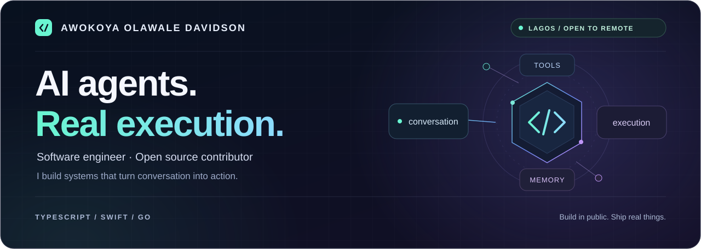
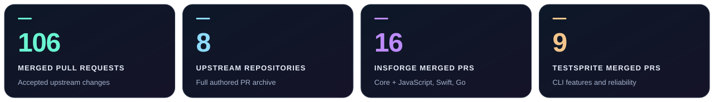

  <picture>
    <source media="(max-width: 640px)" srcset="./assets/profile-hero-mobile.svg" />
    
  </picture>

<h1 align="center">Hi, I'm Davidson.</h1>

  <strong>AI-native software engineer · Open source contributor · Former OpenSRE core maintainer</strong> 
  Lagos, Nigeria · Open to remote engineering opportunities

  
  
  
  

  
  &nbsp;
  

  <a href="#open-source-contributions">Open source</a> &nbsp; / &nbsp;
  <a href="#featured-build-drexii">Drexii</a> &nbsp; / &nbsp;
  <a href="#engineering-toolkit">Toolkit</a> &nbsp; / &nbsp;
  <a href="#recognition--community">Recognition</a> &nbsp; / &nbsp;
  <a href="#lets-work-together">Contact</a>

---

I build AI agents that can act across connected tools, and I contribute to the software those agents depend on. My open source work includes a Go SDK, streaming AI responses in Swift, safer backend APIs, and fixes to agent runtimes and developer CLIs.

I'm currently building **[Drexii](https://drexii.vercel.app)**, a conversational workspace with **11 integrations and 50+ tools**. I like owning the work from the first interface to the last regression test.

## Open source contributions

<picture>
  <source media="(max-width: 640px)" srcset="./assets/contribution-impact-mobile.svg" />
  
</picture>

**106 merged PRs · 8 upstream repositories · 148 authored PRs** in the public contribution archive. Seven repositories have merged work; Nuxt has a closed proposal. Snapshot: **15 October 2026**.

**[Browse the complete contribution archive ↗](./CONTRIBUTIONS.md)**

### Selected work

| Project | What I contributed | Merged work |
| :--- | :--- | :--- |
| **[OpenSRE](https://github.com/Tracer-Cloud/opensre)** | Former paid core maintainer. Added Claude Code and GitHub Copilot CLI providers; fixed provider retry handling and guarded CI repair against a changing source branch. | **77 PRs** · [Claude Code #1168](https://github.com/Tracer-Cloud/opensre/pull/1168) · [Copilot #1533](https://github.com/Tracer-Cloud/opensre/pull/1533) · [Retry handling #3172](https://github.com/Tracer-Cloud/opensre/pull/3172) · [CI repair #6504](https://github.com/Tracer-Cloud/opensre/pull/6504) |
| **[InsForge](https://github.com/InsForge/InsForge)** | Protected system schemas in the SQL editor, fixed dashboard edits for composite primary keys, and blocked anonymous clients from the raw-email endpoint. Also contributed deployment and storage settings. | **8 PRs** · [SQL protection #1041](https://github.com/InsForge/InsForge/pull/1041) · [Composite keys #1584](https://github.com/InsForge/InsForge/pull/1584) · [Email access #1629](https://github.com/InsForge/InsForge/pull/1629) |
| **[InsForge JavaScript SDK](https://github.com/InsForge/InsForge-sdk-js)** | Added HTTP retries and configurable timeouts, request debugging, integration-test CI, and working lint and formatting gates. | **4 PRs** · [Retries #51](https://github.com/InsForge/InsForge-sdk-js/pull/51) · [Debugging #50](https://github.com/InsForge/InsForge-sdk-js/pull/50) · [CI #59](https://github.com/InsForge/InsForge-sdk-js/pull/59) |
| **[InsForge Swift SDK](https://github.com/InsForge/insforge-swift)** | Added streaming chat completions with Server-Sent Events and chunked uploads for large files; resolved existing SwiftLint violations. | **3 PRs** · [Streaming #18](https://github.com/InsForge/insforge-swift/pull/18) · [Uploads #20](https://github.com/InsForge/insforge-swift/pull/20) · [Lint #25](https://github.com/InsForge/insforge-swift/pull/25) |
| **[InsForge Go SDK](https://github.com/InsForge/insforge-go)** | Built and contributed the Go SDK for authentication, databases, storage, AI, realtime, functions, and email. | **1 PR** · [SDK #1](https://github.com/InsForge/insforge-go/pull/1) |
| **[TestSprite CLI](https://github.com/TestSprite/testsprite-cli)** | Added GitHub Copilot and Windsurf install targets; kept machine-readable stdout clean; improved input validation and HTTP response handling. | **9 PRs** · [Copilot #194](https://github.com/TestSprite/testsprite-cli/pull/194) · [Windsurf #29](https://github.com/TestSprite/testsprite-cli/pull/29) · [Clean stdout #31](https://github.com/TestSprite/testsprite-cli/pull/31) · [Response validation #291](https://github.com/TestSprite/testsprite-cli/pull/291) |
| **[MoleCare MCP](https://github.com/MoleCare/molecare-mcp)** | Fixed bundled terminology resolution and ICD-10 mappings, moved medical knowledge into locale files, and improved configuration docs and registry publishing checks. | **4 PRs** · [Terminology #76](https://github.com/MoleCare/molecare-mcp/pull/76) · [Locales #103](https://github.com/MoleCare/molecare-mcp/pull/103) · [Registry CI #92](https://github.com/MoleCare/molecare-mcp/pull/92) |
| **[Nuxt CLI](https://github.com/nuxt/cli)** | Proposed a fix to keep the working directory at the project root during preview. | **Closed, unmerged** · [Proposal #1235](https://github.com/nuxt/cli/pull/1235) |

### Reviews & issue reports

I also contribute through code review and reproducible bug reports. In **[OpenSRE #6527](https://github.com/Tracer-Cloud/opensre/pull/6527#pullrequestreview-5407646934)**, I ran 86 focused tests and reproduced headless-browser and small-terminal regressions. Other public reviews cover [resumable sessions](https://github.com/Tracer-Cloud/opensre/pull/6262#pullrequestreview-5215051223), [test-shard partitioning](https://github.com/Tracer-Cloud/opensre/pull/5996#pullrequestreview-5106186742), and [installer canaries](https://github.com/Tracer-Cloud/opensre/pull/5972#pullrequestreview-5100086858).

My issue reports include [one invalid credential aborting integration discovery](https://github.com/Tracer-Cloud/opensre/issues/3254), [SDK documentation and storage API mismatches](https://github.com/InsForge/InsForge-sdk-js/issues/58), and [interactive output breaking JSON-mode stdout](https://github.com/TestSprite/testsprite-cli/issues/30).

**[Review and issue evidence ↗](./CONTRIBUTIONS.md#reviews--issue-reports)**

<strong>Explore every authored pull request</strong>

The **[complete contribution archive](./CONTRIBUTIONS.md)** lists all 148 authored PRs across these eight upstream projects, grouped by repository, with their titles, dates, and status. It separates **106 merged changes** from **42 closed, unmerged proposals**.

Browse the current GitHub records: [authored PRs](https://github.com/search?q=author%3ADavidson3556+is%3Apr+is%3Apublic+-user%3ADavidson3556&type=pullrequests) · [merged PRs](https://github.com/search?q=author%3ADavidson3556+is%3Apr+is%3Amerged+is%3Apublic+-user%3ADavidson3556&type=pullrequests).

The archive covers public upstream work outside my own repositories. The broader GitHub searches also include professional product work, which is excluded from these open source totals.

## Featured build: Drexii

> **One conversation. Your tools, working together.**

**[Drexii](https://drexii.vercel.app)** is an AI agent platform I built to turn requests into actions across a connected workspace. **[Featured in TestSprite's project gallery](https://www.testsprite.com/discover).**

| Product | Engineering |
| :--- | :--- |
| **11 integrations, 50+ tools** in one chat interface | Nuxt 4, TypeScript, and InsForge |
| Actions across email, calendars, documents, and team workflows | Multi-model routing with Claude, DeepSeek, and Gemini |
| Chained automations with persistent context | Memory, voice input/output, and a confirm-before-act layer |

<strong>See the integrations</strong>

Gmail · Slack · Notion · Jira · Linear · Asana · Google Calendar · Google Drive · Discord · Zendesk · Salesforce

**[Explore Drexii ↗](https://drexii.vercel.app)** &nbsp; · &nbsp; **[More projects in my portfolio ↗](https://davidson.vercel.app)**

## Engineering toolkit

| Area | Technologies and focus |
| :--- | :--- |
| **Languages** | TypeScript · JavaScript · Python · Go · Swift |
| **Web & product** | React · Next.js · Vue · Nuxt · Node.js · Tailwind CSS |
| **AI systems** | Agent orchestration · MCP · Tool integrations · Streaming · Model routing |
| **Data & delivery** | PostgreSQL · MongoDB · Docker · Vercel · GitHub Actions |
| **Reliability** | API validation · Authentication boundaries · SDK design · Regression testing · Code review |

## Recognition & community

| Recognition | Result |
| :--- | :--- |
| **[InsForge PR Hackathon LW1](https://insforge.dev/blog/insforge-pr-hackathon)** | **1st place globally** · $1,000 prize |
| **[TestSprite Season 2 Hackathon](https://www.testsprite.com/hackathon-s2)** | **4th place** · $150 prize |
| **TestSprite CLI improvement bounty** | $200 in merged PR rewards |
| **OpenAI Codex for Open Source** | Selected maintainer · 6 months of ChatGPT Pro |
| **GitHub Maintainer Advisory Network** | Selected member |

## Let's work together

I'm open to **remote software engineering roles**, especially in AI agents, developer tools, and product engineering. My contribution archive is a good place to see how I approach real bugs, APIs, and code review.

**[Email me](mailto:olawaledavidson1@gmail.com)** &nbsp; · &nbsp; **[Connect on LinkedIn](https://www.linkedin.com/in/olawaledavidson)** &nbsp; · &nbsp; **[View my portfolio](https://davidson.vercel.app)** &nbsp; · &nbsp; **[Follow my work](https://x.com/AwokoyaD)**

---

  <strong>Build in public. Ship real things. Let the work speak.</strong>

